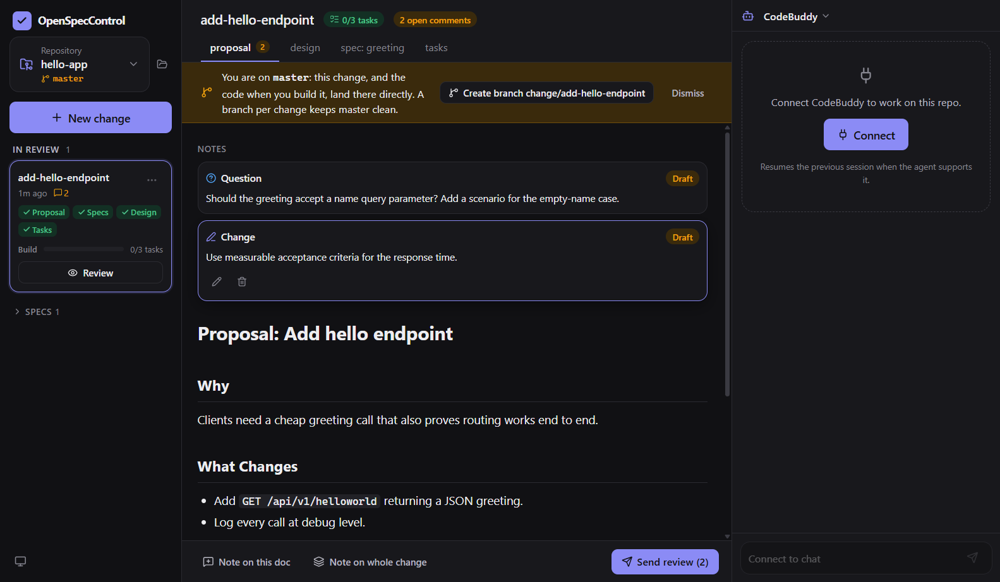
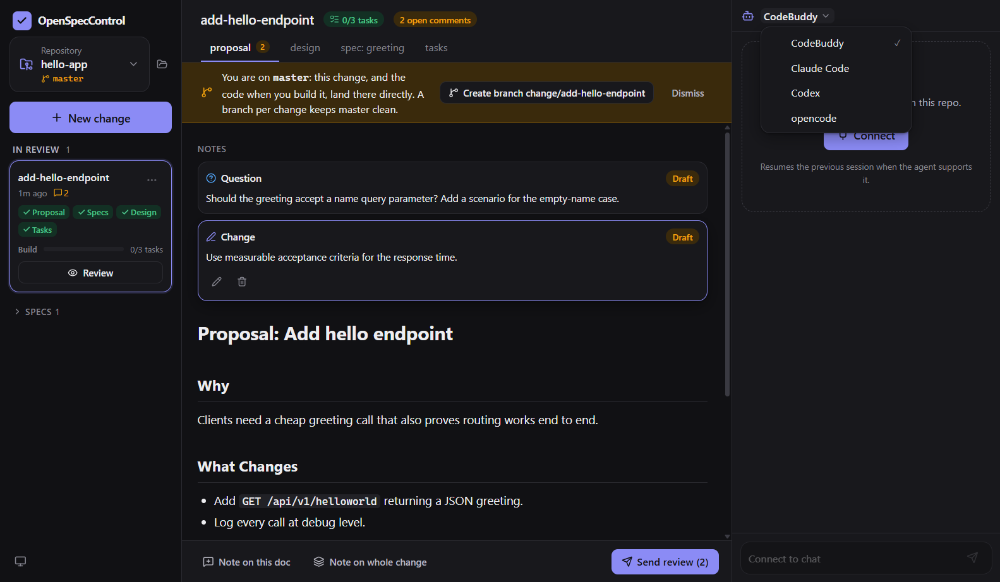

# OpenSpecControl

**A desktop app for spec-driven development with AI coding agents.**

OpenSpecControl helps you turn an idea into an [OpenSpec](https://github.com/Fission-AI/OpenSpec) proposal with the help of an AI coding agent, review it like a document, and let the same agent build it, with everything that matters (comments, review rounds, agent transcripts) kept on your machine.

> **Status: early development (0.1.0).** The app is functional on Windows; the macOS and Linux builds, code signing and the first published release are still pending verification. Handing changes off to [Orca](https://www.onorca.dev/) and a board that monitors many changes at once are **not** implemented yet: see the [Roadmap](#roadmap).



---

## Features

### 1. Proposal generation with your agent of choice

- Generate OpenSpec proposals (`proposal.md`, `design.md`, `tasks.md`, spec deltas) from a plain-language requirement.
- Works with **CodeBuddy**, **Claude Code**, **Codex** and **opencode** through the [Agent Client Protocol (ACP)](https://agentclientprotocol.com/), plus custom agents declared in `agents.json` (see [Configuration](#configuration)).
- Uses each agent's native OpenSpec commands (`/opsx:*`, `$openspec-*`, `/opsx-*`), so the output is the same as running OpenSpec in a terminal.
- Live agent panel: messages, tool calls, plans, token/context usage, and permission or question prompts that you answer from the UI.
- Choose the agent and model per session; resume previous sessions.



### 2. Document-style review

- Comment on proposals, designs and specs by text selection or by block, with typed comments: _Change this_, _Ask a question_, _Remove_, _Comment_ and _Approve_.
- Send all comments to the agent as a review round, get a verdict per comment, and see word-level diffs between revisions.
- Built-in validation with `openspec validate` and warnings for stale artifacts (a file written before something it depends on changed).

### 3. One rail, several repositories

- Open several repositories at once (up to 8): each one gets its own collapsible section in the rail — name, branch, agent status and pending decisions — with its changes grouped by stage: _Drafting_, _In review_, _Ready to build_, _Building_ and _Done_, with the progress read from `tasks.md`.
- One repository is **active** at a time in the document and agent panels; switching keeps what you had open, and opening a change from another repository's section activates it.
- Agents keep working in background repositories: their sections stay up to date, and native notifications, a taskbar/dock badge and a "(n) Needs you" window title name the repository that needs you while the window is in the background.
- Optional **review history in the repo**: comments and rounds are exported to `openspec/changes/<change>/.openspeccontrol-review.json`, so they travel with the branch and the pull request.

### 4. Git and spec lifecycle

- Create a branch for a change and commit only that change's files, on demand.
- Read-only view of the current specs and of archived changes, with the review history OpenSpecControl kept for them.
- Verify, sync specs and archive steps run from the UI after review and merge.

### 5. Local-first desktop app

- Native desktop app for Windows, macOS and Linux built with Electron: native folder picker, menus, notifications, safe close and automatic updates.
- All data stays on your machine: a SQLite database in `~/.openspeccontrol`, no cloud service and no listening port.
- Uses the CLIs and logins you already have (`openspec`, your agent's CLI, `git`); OpenSpecControl does not provide models or accounts.

---

## Quick start

1. **Install the prerequisites** (details in [Requirements](#requirements)): [Node.js](https://nodejs.org) (it provides `npx`), `git`, the OpenSpec CLI and at least one coding agent, signed in:

   ```bash
   npm install -g @fission-ai/openspec
   ```

2. **Download the installer** for your system from the [latest release](https://github.com/ricbalda/openspeccontrol/releases/latest) of `ricbalda/openspeccontrol`:

   | System  | File                                                        | Notes                                                                 |
   | ------- | ----------------------------------------------------------- | --------------------------------------------------------------------- |
   | Windows | `OpenSpecControl-<version>-<arch>-setup.exe` (`x64`, `arm64`) | Per-user install, no administrator needed                            |
   | macOS   | `OpenSpecControl-<version>.dmg` (Intel and Apple Silicon)   | Drag the app to _Applications_                                        |
   | Linux   | `OpenSpecControl-<version>-<arch>.AppImage` or the `.deb`   | `chmod +x` the AppImage, or install the `.deb` with `apt`/`dpkg`      |

   There is no published release yet; until the first one is out, [build it from source](#development). If your system warns about an unsigned app, see [Troubleshooting](#troubleshooting).

3. **Open OpenSpecControl** and check **Ayuda → Diagnóstico de dependencias**: `node`, `npx`, `openspec` and `git` must show as found, each missing one comes with the command to install it.
4. **Add a folder** with **Archivo → Añadir carpeta…** (`Ctrl/Cmd+O`). The folder is scanned for repositories that have an `openspec/` folder or a `.git` folder. A repository without OpenSpec offers **Initialize OpenSpec**.
5. **Try it on a demo repository** if you want to see the whole flow first: **Ayuda → Crear repositorio de demostración…** creates a small repo with a change waiting in _In review_ and selects it.
6. **Work a change end to end**: press **Connect** in the agent panel, _Propose_ a change (or open an existing one), comment on the documents, **Send review**, then **Build it**, _Verify_, _Sync specs_ and _Archive_, with **Create branch** and **Commit** whenever you want them.

The application menus (Archivo, Editar, Ver, Ventana, Ayuda) are in Spanish; the rest of the interface is in English.

Guía de uso: [docs/QuickGuide.md](docs/QuickGuide.md)

## Requirements

| What                         | Why                                                                                                 |
| ---------------------------- | --------------------------------------------------------------------------------------------------- |
| [Node.js](https://nodejs.org) with `npx` | Runs the OpenSpec CLI and the adapters of Claude Code and Codex. It is **not** bundled in the app. |
| `git`                        | Branches, commits and the pending-files view.                                                       |
| [OpenSpec CLI](https://github.com/Fission-AI/OpenSpec) | `npm install -g @fission-ai/openspec`                                      |
| One agent, signed in         | CodeBuddy (`codebuddy`), Claude Code, Codex or opencode (`opencode`), logged in on your machine.    |

- **You do not need Node.js 24 to _use_ the app.** The app ships with its own runtime (Electron includes Node 24 and the `node:sqlite` module that stores your data). The Node.js of your system is only used to run the CLIs above.
- **The agent adapters are not bundled either.** Claude Code and Codex are started with `npx` (`@agentclientprotocol/claude-agent-acp`, `@agentclientprotocol/codex-acp`), which downloads them the first time; CodeBuddy (`codebuddy --acp`) and opencode (`opencode acp`) run the CLI you installed.
- To **develop** the app you need Node.js 22.13 or later (CI runs 22 and 24) and npm 12.

## How it fits together

OpenSpecControl has no web server. The interface (React) and the core (Node.js, in Electron's main process) talk over Electron IPC through a small, explicit bridge: `window.osc`.

```
Renderer (React 19, sandbox, contextIsolation)        src/renderer
   │  window.osc.*   (one explicit function per operation, no generic invoke)
   ▼
Preload (CJS) ── ipcRenderer.invoke('osc:<method>') · send('osc:client-msg') · on('osc:server-msg')   src/preload
   ▼
Main (ESM)                                             src/main
   ├─ index.ts   lifecycle: single instance, window, menu, safe close, updater
   ├─ ipc.ts     one handler per method · sender check · zod validation · { ok, data } | { ok: false, error }
   ├─ desktop/   window state, menu, notifications, badge, updater, login-shell env, tools, demo repo
   └─ core/      OscCore (never imports `electron`): ACP hub, openspec CLI, git, workspace, review, SQLite
        │
        └─ child processes: agents (ACP over stdio, cwd = the repo) · `openspec --json` · `git`
```

- The core watches each repository's `openspec/` folder (chokidar) and pushes changes to the window as events, so the rail and the documents stay current without polling from the interface.
- Reloading the window is safe: the interface subscribes again and the core replays the session and the event log of the selected repo.
- The IPC contract (`OscApi`, the channels and the error envelope) lives in `src/shared/ipc.ts`.

## Configuration

OpenSpecControl needs no configuration to start. These environment variables are read when it launches; on macOS and Linux they are also read from your login shell, so exporting them in your shell profile is enough.

| Variable                | Default                              | What it does                                                                   |
| ----------------------- | ------------------------------------ | ------------------------------------------------------------------------------ |
| `OSC_DATA`              | `~/.openspeccontrol`                 | Data folder (database, folders you added, `agents.json`, window state).        |
| `OSC_DB`                | `<data folder>/openspeccontrol.db`   | Path of the SQLite database.                                                   |
| `OSC_NO_UPDATE_CHECK`   | unset                                | `1` turns the automatic update check off (offline or air-gapped machines).     |
| `DEFAULT_AGENT`         | `codebuddy`                          | Agent selected for a repo that has none yet (`codebuddy`, `claude`, `codex`, `opencode` or a custom id). |
| `OPENSPEC_BIN`          | `openspec`                           | Path or name of the OpenSpec CLI.                                              |
| `OPENSPEC_TELEMETRY`    | `0` for the app's own CLI calls      | Set it to `1` to let the OpenSpec CLI send telemetry again.                    |
| `REPOS_ROOT`            | unset                                | A folder that is always part of the workspace, in addition to the ones you add. |
| `REPO_SCAN_DEPTH`       | `4`                                  | How deep a folder is scanned for repositories.                                 |
| `MAX_DOC_BYTES`         | `2097152` (2 MiB)                    | Largest document the app will load.                                            |

**Custom agents** go in `~/.openspeccontrol/agents.json` (picked up without restarting). An entry with the id of a built-in agent overrides it:

```json
[
  {
    "id": "gemini",
    "label": "Gemini",
    "cmd": "gemini",
    "args": ["--experimental-acp"],
    "openspecTool": "gemini",
    "style": "slash"
  }
]
```

`style` is `slash` (`/opsx:<action>`), `skill` (`$openspec-<skill>`) or a template such as `/custom:{action} {args}`.

## What OpenSpecControl writes

| Where                                                                    | What                                                                                                  |
| ------------------------------------------------------------------------ | ----------------------------------------------------------------------------------------------------- |
| `~/.openspeccontrol/` (or `OSC_DATA`)                                    | `openspeccontrol.db` (+ `-wal`, `-shm`): sessions, agent events, comments and review rounds. `config.json`: the folders you added. `agents.json`: custom agents (you create it). `window-state.json`: window size and position. `imported-from-studio.json`: marker of the one-time [import from OpenSpec Studio](#migrating-from-openspec-studio). |
| `openspec/changes/<change>/.openspeccontrol-review.json`                 | Only for repos where you turn on _Keep review history_ in the repo rail. Comments and rounds of that change; commit it with the change. |
| Your repositories                                                        | The OpenSpec artifacts your agent and the `openspec` CLI write, and the branches and commits you ask for. Nothing is committed unless you press **Commit**. |
| Electron's `userData` folder: `%APPDATA%\OpenSpecControl` (Windows), `~/Library/Application Support/OpenSpecControl` (macOS), `~/.config/OpenSpecControl` (Linux) | Chromium's own caches (`Local Storage`, `GPUCache`, ...) and the interface preferences (theme, panel widths, last repo). This is **not** the data folder above; deleting it loses no review data. |

**Ayuda → Abrir carpeta de datos** opens `~/.openspeccontrol` in your file manager.

## Platforms

| Platform | Installer                                    | Notes                                                                                                   |
| -------- | -------------------------------------------- | ------------------------------------------------------------------------------------------------------- |
| Windows  | NSIS, per user, `x64` and `arm64`            | Developed and tested here. Repos inside WSL are reachable as network folders (`\\wsl$\<distro>\...` or `\\wsl.localhost\<distro>\...`) with the CLIs installed on the Windows side. |
| macOS    | `.dmg` and `.zip`, universal (Intel + Apple Silicon) | Not verified on a real Mac yet. On first launch from the Dock the login shell is read to find `nvm`, `volta` or Homebrew. |
| Linux    | `.AppImage` and `.deb`, `x64` and `arm64`    | Not verified on a real distribution yet. Per electron-updater, updating a `.deb` shows a system authentication prompt, while the AppImage replaces itself. |

When the app runs on Linux against a Windows drive (`/mnt/c/...`), file watching switches to polling because inotify is unreliable there.

## Troubleshooting

- **`openspec`, `npx` or `git` is "not found".** Open **Ayuda → Diagnóstico de dependencias**: it lists what the app found and the command to install what is missing. On Windows, make sure the tool works in a new terminal, then restart the app so it sees the new `PATH`.
- **macOS/Linux: it works from the terminal but not from the Dock or launcher.** Apps opened from the Dock inherit a minimal `PATH`. OpenSpecControl asks your login shell (`$SHELL -ilc`) for the real one and falls back to `/opt/homebrew/bin`, `/usr/local/bin`, `~/.volta/bin` and `~/.local/bin`. If your tools live somewhere else, add the directory in your shell profile (`~/.zprofile` or `~/.profile`), or set `OPENSPEC_BIN` to the full path of the CLI. If your shell profile waits for input or takes too long, the lookup gives up after 5 seconds and the fallback paths are used.
- **Windows SmartScreen says "Windows protected your PC".** Builds that are not code-signed trigger it: choose _More info_ → _Run anyway_. Signed releases are built when the signing secrets are configured (see [Crear un release](#crear-un-release)).
- **macOS Gatekeeper says the app "cannot be opened".** An app that is not notarized is blocked the first time: right-click it → _Open_ → _Open_, or run `xattr -dr com.apple.quarantine /Applications/OpenSpecControl.app`.
- **The agent never connects.** Check that the agent's own CLI works in a terminal and is signed in. Claude Code and Codex are started with `npx`, so the first connection needs network access to download their adapter, and `npx` must be on the `PATH`.
- **Opening the app a second time does nothing.** OpenSpecControl allows one instance per user (two would share the same database and agent sessions): launching it again only focuses the existing window.
- **The app does not look for updates.** Updates only work in installed builds, and `OSC_NO_UPDATE_CHECK=1` turns them off. **Ayuda → Buscar actualizaciones…** forces a check.
- **Something looks stale.** **Archivo → Volver a escanear repos** rescans your folders; **Ver → Recargar** reloads the window and replays the session.

## Migrating from OpenSpec Studio

OpenSpecControl is built on [OpenSpec Studio](https://github.com/baabullah/openspec-studio) 0.3.x and replaces it as a desktop app; it has no web mode, no local server and no npm CLI. If you used Studio:

- **Your data is imported automatically, once.** On the first launch, if `~/.openspeccontrol/openspeccontrol.db` does not exist and `~/.openspec-studio/studio.db` does, OpenSpecControl copies the database (folders, comments, review rounds and resumable sessions), `config.json` and `agents.json` into `~/.openspeccontrol`. Studio's folder is never modified or deleted, and the import is not repeated. If it fails, the app starts empty and logs the reason; delete `~/.openspeccontrol` to try again. Preferences kept by the browser (theme, panel widths, last repo) are not imported.
- **Environment variables were renamed.** `STUDIO_DATA` → `OSC_DATA`, `STUDIO_DB` → `OSC_DB` and `STUDIO_NO_UPDATE_CHECK` → `OSC_NO_UPDATE_CHECK`. The old names are not read. `DEFAULT_AGENT`, `OPENSPEC_BIN`, `OPENSPEC_TELEMETRY`, `REPOS_ROOT`, `REPO_SCAN_DEPTH` and `MAX_DOC_BYTES` keep their names. The variables that configured Studio's server (`PORT`, `HOST`, `ALLOWED_HOSTS`) no longer exist.
- **Both review files can live side by side.** Review history that Studio exported in a repo is `openspec/changes/<change>/.studio-review.json`. OpenSpecControl reads it when the change has no `.openspeccontrol-review.json`, and only ever writes the new name. Once you have exported with OpenSpecControl you can delete the old file from the repo.
- **Do not use both apps on the same repository at the same time.** The import is a copy, not a link: each app keeps its own data folder, so the same repo would get duplicated agent sessions and comments that drift apart. Pick one app per repo, and close Studio before the first launch of OpenSpecControl if you want a fully up-to-date import.

## Tech stack

TypeScript end to end: Electron 45, React 19, Vite (electron-vite), Tailwind CSS, zustand, Node.js in the main process (chokidar, cross-spawn), SQLite (`node:sqlite`), the ACP SDK, Zod, electron-builder and electron-updater, with Vitest, ESLint and Prettier.

## Known limitations

- macOS and Linux builds, code signing, notarization and the automatic update flow have not been verified on real machines yet.
- A single window: several repositories can be open in the rail at once (up to 8), but only the active one is shown in the document and agent panels; there are no split panes or multiple windows.
- Node.js, the OpenSpec CLI and the agent CLIs are external requirements; the app detects them and tells you how to install them, but does not bundle them.

## Roadmap

Planned for later changes (none of this exists yet):

1. **Handoff to Orca.** On approval, create an isolated [Orca](https://www.onorca.dev/) worktree for the change and launch the implementation agent there; execution backends (Orca or direct ACP).
2. **Multi-change monitoring board** across worktrees: per-change progress from `tasks.md`, agent liveness and "needs attention" detection, status written back to Orca, and overlap detection between changes that touch the same spec.
3. Verification and signed releases on macOS and Linux, then the first published release.

## Development

Requirements: Node.js 22.13 or later (CI runs 22 and 24), npm 12, and the CLIs from [Requirements](#requirements) if you want to try the agent flow.

```bash
git clone https://github.com/ricbalda/openspeccontrol.git
cd openspeccontrol
npm install            # postinstall: install-electron + electron-builder install-app-deps
npm run dev            # electron-vite dev: the app with hot reload of the interface
```

| Script                 | What it does                                                                      |
| ---------------------- | --------------------------------------------------------------------------------- |
| `npm run dev`          | Development run (HMR for the renderer, the main process restarts on change)       |
| `npm start`            | Preview of the production build, without packaging                               |
| `npm test`             | Vitest: `main` project (Node, temporary `OSC_DATA`) and `renderer` project (jsdom) |
| `npm run lint`         | ESLint                                                                            |
| `npm run format`       | Prettier                                                                          |
| `npm run typecheck`    | `tsc` for main and preload (`tsconfig.node.json`) and for the renderer (`tsconfig.web.json`) |
| `npm run build`        | typecheck + `electron-vite build` into `out/`                                     |
| `npm run dist`         | build + installer for the current system, into `release/<version>/`               |
| `npm run dist:win`, `dist:mac`, `dist:linux` | Installers for one platform (see [Crear un release](#crear-un-release)) |
| `npm run dist:dir`     | Unpacked app folder, no installer: the quickest packaging check                   |
| `npm run demo-repo`    | Create the demo repo (`node scripts/demo-repo.mjs [folder] [--tools claude]`)      |

Source layout: `src/main` (Electron main process; `core/` is the Electron-free core `OscCore`, `desktop/` the native shell), `src/preload` (the `window.osc` bridge), `src/renderer` (React), `src/shared` (IPC and protocol types), `test/main` and `test/renderer`, `scripts/` (packaging, CI smoke test, demo repo), `openspec/` (the specs and the migration change). `CLAUDE.md` has the conventions for working in the code base.

Signing and notarization are described in `build/SIGNING.md`. The release guide below is kept in Spanish.

### Crear un release

Los releases los construye y publica en **borrador** el workflow `.github/workflows/release.yml` cuando se empuja una etiqueta `v*`. La integración continua (`.github/workflows/ci.yml`) debe estar en verde antes.

**1. Configura los secretos una sola vez** (GitHub → _Settings_ → _Secrets and variables_ → _Actions_ → _New repository secret_). Solo se necesitan los **nombres** de la tabla; los valores nunca van al repositorio (detalle de cada credencial en `build/SIGNING.md`). Si falta alguno, el workflow falla en su primer trabajo, antes de construir nada, y no se genera ningún artefacto sin firmar.

| Plataforma | Secretos                                                                                                              | Qué contienen                                                                 |
| ---------- | --------------------------------------------------------------------------------------------------------------------- | ----------------------------------------------------------------------------- |
| Windows    | `WIN_CSC_LINK`, `WIN_CSC_KEY_PASSWORD`                                                                                | Certificado de firma `.pfx` en base64 y su contraseña                         |
| Windows    | `AZURE_TENANT_ID`, `AZURE_CLIENT_ID`, `AZURE_CLIENT_SECRET`, `AZURE_SIGN_ENDPOINT`, `AZURE_SIGN_ACCOUNT`, `AZURE_SIGN_PROFILE`, `AZURE_SIGN_PUBLISHER` | Alternativa al certificado: Azure Trusted Signing (basta **una** de las dos vías) |
| macOS      | `CSC_LINK`, `CSC_KEY_PASSWORD`                                                                                        | Certificado _Developer ID Application_ `.p12` en base64 y su contraseña       |
| macOS      | `APPLE_API_KEY`, `APPLE_API_KEY_ID`, `APPLE_API_ISSUER`                                                               | Notarización con clave de API de App Store Connect (`APPLE_API_KEY` es el contenido del `.p8`) |
| macOS      | `APPLE_ID`, `APPLE_APP_SPECIFIC_PASSWORD`, `APPLE_TEAM_ID`                                                            | Alternativa de notarización con Apple ID (basta **una** de las dos vías)      |

Linux no se firma. El release usa el `GITHUB_TOKEN` del propio workflow, no hace falta otro secreto.

**2. Sube la versión y etiqueta.** La etiqueta debe ser exactamente `v` + la versión de `package.json`, o el workflow falla:

```bash
npm version 0.2.0 --no-git-tag-version   # actualiza package.json y package-lock.json
git commit -am "chore: versión 0.2.0"    # PR o push a main; espera a que CI quede en verde
git tag v0.2.0
git push origin v0.2.0                    # dispara el workflow Release
```

Una versión con guion (`0.2.0-beta.1`) se publica como pre-release.

**3. Espera al workflow `Release`** (pestaña _Actions_). Verifica etiqueta, secretos y tests; construye Windows, macOS y Linux en runners nativos con `npm run dist:win`, `npm run dist:mac` y `npm run dist:linux`; y crea el release **en borrador**.

**4. Revisa el borrador** (_Releases_ → _Draft_). Debe contener, por plataforma:

- Windows: un instalador por arquitectura, `OpenSpecControl-<version>-<arch>-setup.exe` (`x64` y `arm64`), y `latest.yml`.
- macOS: `OpenSpecControl-<version>.dmg`, el `.zip` universal y `latest-mac.yml`.
- Linux: `.AppImage` y `.deb` para `x64` y `arm64`, y `latest-linux.yml` (y el equivalente de `arm64`).
- Los `.blockmap` (descarga diferencial).

**5. Publícalo** con _Publish release_. Hasta ese momento la actualización automática (`electron-updater`) no lo ve: los `latest*.yml` son lo que lee la app instalada. Si el borrador está mal, bórralo en GitHub y vuelve a empujar la etiqueta (`git push --delete origin v0.2.0`, corrige y repite).

Para probar el empaquetado en local, sin CI ni credenciales (los builds quedan **sin firmar**): `npm run dist:dir` (carpeta sin instalador), `npm run dist:win`, `npm run dist:mac` (solo en macOS) o `npm run dist:linux`; salen en `release/<version>/`.

> **Estado de verificación.** Los dos workflows están implementados y su sintaxis se valida en `npm test`, pero **no se han ejecutado en GitHub**: la matriz de CI en verde y un tag de prueba que genere el borrador con los tres instaladores están pendientes. La firma real y la notarización tampoco se han podido verificar (requieren credenciales y macOS).

## Security

OpenSpecControl is a local desktop app with no network surface:

- **No ports, no network authentication.** The interface talks to the app core over Electron IPC (`contextBridge`); the app never opens a listening socket. Everything stays on your machine (`~/.openspeccontrol`, the app's data folder, and the repositories you add).
- **Hardened renderer.** The window is created with fixed `webPreferences`: `contextIsolation` and the Chromium sandbox on, `nodeIntegration` off, `webSecurity` on, no spellcheck, and drag-and-drop never navigates. There is no `process` or `require` in the renderer.
- **Strict Content-Security-Policy** (`default-src 'self'`, no objects, no frames, no base): scripts, styles and connections can only come from the app itself. The development server (HMR included) works under the same policy.
- **Deny-by-default permissions.** Every permission request is refused except `clipboard-sanitized-write` (what a copy button needs); `<webview>` tags, `window.open` and in-page navigation are all blocked.
- **Validated IPC.** Every message is checked before any core code runs: only the main window's main frame on the origin the app loaded, arguments validated with zod schemas and size caps, and file access sandboxed to the repositories you added and the data folder.
- **Agents keep their own gates.** Coding agents run with the CLIs you installed (system `node`/`npx`, never the app's Electron), as your user. Their permission and elicitation prompts are relayed to you in the UI; OpenSpecControl never auto-approves a command behind your back.
- **Hardened binary.** Packaged builds flip Electron's fuses: `RunAsNode`, `NODE_OPTIONS` and the `--inspect` CLI switch are disabled, and ASAR integrity validation plus `OnlyLoadAppFromAsar` are enabled.

## License and credits

OpenSpecControl is released under the [MIT License](LICENSE) (© Ricardo Balda).

It is built on [OpenSpec Studio](https://github.com/baabullah/openspec-studio) by Fridayana Baabullah (MIT License): the review, agent and OpenSpec logic comes from it, moved into an Electron desktop app. Its copyright and license notice is reproduced in [NOTICE](NOTICE) and ships with every installer. OpenSpecControl also works with [OpenSpec](https://github.com/Fission-AI/OpenSpec) by Fission AI and, in the planned handoff, with [Orca](https://github.com/stablyai/orca).
