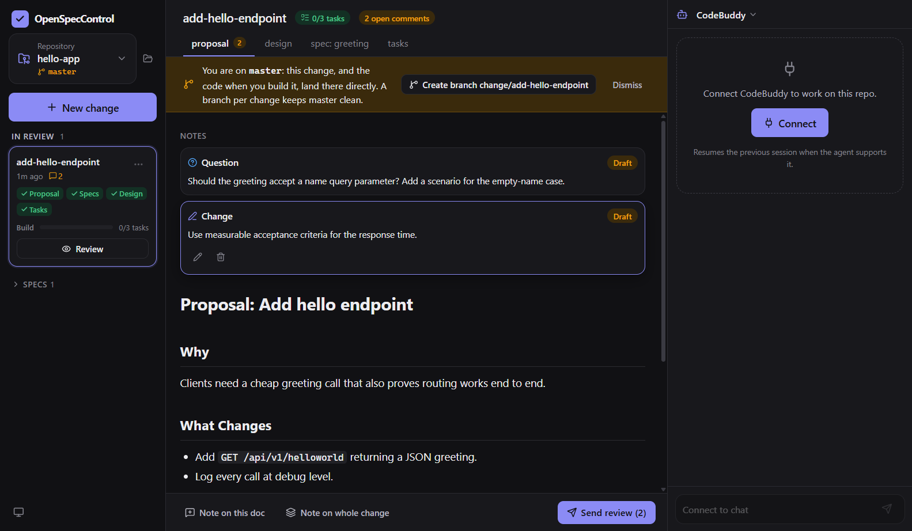
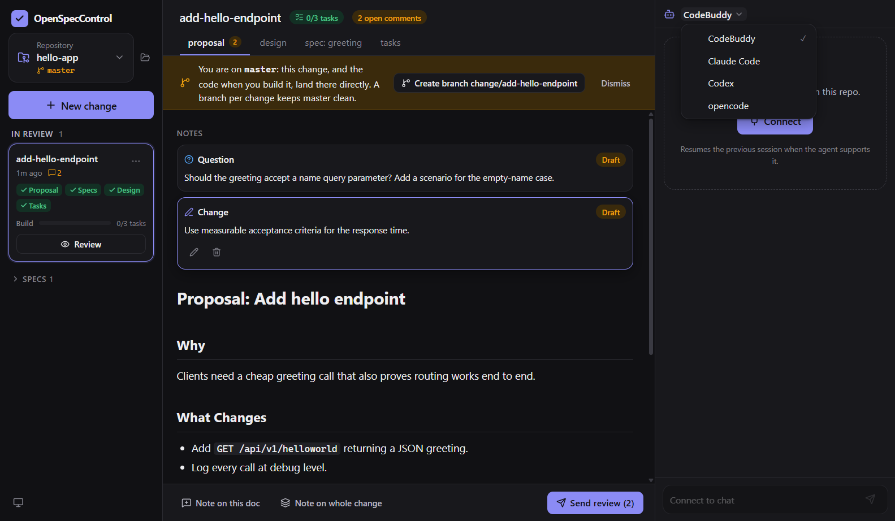

# OpenSpecControl: guía rápida

Manual de uso para quien instala la app por primera vez. Los nombres de botones, menús y avisos están tal como aparecen en la interfaz: los **menús nativos** (Archivo, Editar, Ver, Ventana, Ayuda) están en español; el resto de la interfaz está en inglés.



## 1. Qué es

OpenSpecControl es una app de escritorio (Electron) para **revisar cambios de [OpenSpec](https://github.com/Fission-AI/OpenSpec) como si fueran un documento** y dejar que un agente de código (CodeBuddy, Claude Code, Codex, opencode…) los redacte, los corrija según tus comentarios y los implemente. Es para quien ya trabaja con OpenSpec y agentes de código y quiere tener propuesta, specs, diseño, tareas, comentarios y rondas de revisión en un solo sitio. Todo queda en tu máquina: no hay servicio en la nube ni puerto abierto, y la app no incluye modelos ni cuentas (usa los CLI y sesiones que ya tienes).

## 2. Requisitos e instalación

**Antes de abrir la app** necesitas, instalados y en el `PATH`:

| Herramienta | Para qué | Instalar |
| --- | --- | --- |
| Node.js (con `npx`) | Ejecuta el CLI de OpenSpec y los adaptadores de Claude Code y Codex | [nodejs.org](https://nodejs.org) |
| `git` | Ramas, commits y archivos pendientes | [git-scm.com](https://git-scm.com) |
| CLI de OpenSpec | Validación, init y comandos del flujo | `npm install -g @fission-ai/openspec` |
| Un agente con sesión iniciada | CodeBuddy (`codebuddy`), Claude Code, Codex u opencode (`opencode`) | Según cada agente |

No necesitas Node 24 para _usar_ la app: Electron trae su propio runtime. El Node del sistema solo se usa para los CLI de arriba.

**Instaladores** (carpeta `release/<versión>/` si los construyes tú; en GitHub, `ricbalda/openspeccontrol`):

| Sistema | Archivo |
| --- | --- |
| Windows | `OpenSpecControl-<versión>-<arch>-setup.exe` (`x64` o `arm64`), instalación por usuario, sin administrador |
| macOS | `OpenSpecControl-<versión>.dmg` (Intel y Apple Silicon): arrastra la app a _Applications_ |
| Linux | `OpenSpecControl-<versión>-<arch>.AppImage` (`chmod +x`) o el `.deb` (`apt`/`dpkg`) |

> **Estado actual (0.1.0).** Todavía **no hay ningún release publicado**: hasta que salga el primero, hay que construirla desde el código (`npm install` y `npm run dev`, o `npm run dist` para generar el instalador; ver el [README](../README.md#development)). Windows es la plataforma probada; las compilaciones de macOS y Linux y la firma de código **no se han verificado** en máquinas reales. Si el sistema avisa de una app sin firmar (SmartScreen en Windows, Gatekeeper en macOS), mira la sección [Solución de problemas](#10-solución-de-problemas).

**Comprobar herramientas.** Al abrir la app, entra en **Ayuda → Diagnóstico de dependencias**: muestra `Node.js`, `npx`, `OpenSpec CLI` y `git` con su estado (_Found_ / _Missing_), versión y ruta. Para cada herramienta que falte aparece el comando de instalación y un botón de copiar; instálala en una terminal, reinicia la app y pulsa **Re-check**. Si falta `openspec` o `node`, también verás el aviso **External tools missing** en la pantalla "Set up OpenSpec" y en el panel del agente.

## 3. Primer arranque

La ventana tiene tres columnas: a la izquierda el **rail** (repositorio y cambios), en el centro el **documento** y a la derecha el **panel del agente**. Los anchos se ajustan arrastrando el borde del panel del agente (doble clic para volver al ancho por defecto).

1. **Añadir una carpeta.** Con la app vacía verás "Add the folder with your repos" y el botón **Add folder**. También: **Archivo → Añadir carpeta…** (`Ctrl/Cmd+O`) o **Add folder…** en el selector de repositorios.
   - **Browse…** abre el selector nativo de carpetas y la añade al momento.
   - Para carpetas de red o de WSL puedes escribir o pegar la ruta y pulsar **Add this folder** (`~` se expande a tu carpeta personal). En WSL usa `\\wsl$\<distro>\...` o `\\wsl.localhost\<distro>\...`.
   - Puede ser la carpeta que contiene tus repos o un repo suelto. La app lista los repos con carpeta `openspec/` o `.git` hasta **4 niveles** dentro.
2. **Elegir repositorio.** Pulsa el selector "Repository" (arriba del rail). Hay un filtro, un botón para volver a escanear (**Rescan folders**) y, en cada carpeta añadida, una **X** para quitarla de la lista (no borra nada en disco). Cada repo muestra la insignia **OpenSpec** o "not set up", y un punto verde si tiene un agente conectado. Si se detuvo el escaneo de una carpeta enorme verás **partial**: añade una carpeta más concreta. El botón con la carpeta, junto al selector, muestra el repo en el explorador de archivos.
3. **Inicializar OpenSpec.** Si el repo no tiene OpenSpec, el centro muestra **Set up OpenSpec in this repo**: elige el agente (botones con el nombre de cada uno) y pulsa **Initialize OpenSpec**. Crea la carpeta `openspec/` e instala los comandos del flujo para ese agente; no cambia nada más del repo. Tras inicializar aparece el aviso "OpenSpec initialized".
4. **Importación desde OpenSpec Studio (automática, una sola vez).** Si en el primer arranque no existe `~/.openspeccontrol/openspeccontrol.db` y sí `~/.openspec-studio/studio.db`, la app copia carpetas, comentarios, rondas, sesiones, `config.json` y `agents.json` a `~/.openspeccontrol`. La carpeta de Studio no se toca. Las preferencias del navegador (tema, anchos, último repo) no se importan. Si falla, la app arranca vacía; borra `~/.openspeccontrol` para reintentarlo. No uses ambas apps sobre el mismo repo a la vez.

## 4. Probar rápido con el repositorio de demostración

1. **Ayuda → Crear repositorio de demostración…**
2. En el diálogo **Create demo repository**, elige el **Agent** (se propone el activo o el predeterminado) y pulsa **Choose folder…**.
3. Elige con el selector del sistema la carpeta donde crearlo.

Se crea `hello-app` dentro de esa carpeta: un repo git pequeño con una spec principal y el cambio `add-hello-endpoint` esperando en **In review**, que queda seleccionado. Si lo repites, la demo se reinicia. Si el agente elegido no tiene integración con OpenSpec, la demo se crea sin `openspec init`. Al terminar verás "Demo repository created". También puedes crearla desde una terminal: `npm run demo-repo` (`node scripts/demo-repo.mjs [carpeta] [--tools claude|codebuddy|codex|opencode]`).

## 5. Conectar un agente



Agentes incluidos: **CodeBuddy** (`codebuddy --acp`), **Claude Code** (vía `npx`, adaptador ACP), **Codex** (vía `npx`, adaptador ACP) y **opencode** (`opencode acp`). Los dos de `npx` descargan su adaptador la primera vez, así que necesitan red. El agente corre con tu usuario y con el `node`/`npx` del sistema.

1. En el panel de la derecha, abre el nombre del agente (arriba, con la flecha) y elige el que quieras. **Solo se puede cambiar mientras está desconectado**; la elección se recuerda por repo. El agente por defecto es `codebuddy` (se cambia con `DEFAULT_AGENT`).
2. Pulsa **Connect**. El estado pasa por _Starting_, _Ready_ y, mientras trabaja, _Working_ (con cronómetro). Si el agente lo soporta, **retoma la sesión anterior** (aviso "Resumed … session.").
3. Con la sesión activa, la fila de selectores bajo la cabecera (por ejemplo, el modo de permisos) muestra las opciones que el agente ofrece. El medidor "context N %" y el coste, si el agente los informa, están sobre la caja de mensaje.
4. El icono de encendido (**Session**) ofrece **New session** y **Disconnect agent**. **Stop** corta el turno en curso.
5. La caja **Message the agent…** es para charla libre: `Enter` envía, `Shift+Enter` hace salto de línea.

**Permisos y preguntas.** Cuando el agente quiere ejecutar un comando, escribir un archivo o te hace una pregunta, aparece en una franja fija **Needs your decision**, que no se pierde al hacer scroll:

- **Permiso** ("The agent wants to: …"): muestra el comando, ruta o diff, y los botones que ofrece el agente (por ejemplo permitir una vez, permitir siempre o rechazar; los nombres los pone el agente). **La app nunca aprueba nada por ti.**
- **Pregunta** (formulario del agente): chips de opciones (un clic responde si es una sola pregunta de elección), **Yes/No**, campos de texto, y **Submit**/**OK** o **Decline**.
- Si un turno termina por límite de tokens, de pasos, rechazo o error, verás "Stopped: …" y un botón **Continue** para decirle al agente que siga.

**Agentes propios.** Crea `~/.openspeccontrol/agents.json` (se lee sin reiniciar); un `id` igual al de un agente incluido lo reemplaza:

```json
[
  {
    "id": "gemini",
    "label": "Gemini",
    "cmd": "gemini",
    "args": ["--experimental-acp"],
    "openspecTool": "gemini",
    "style": "slash"
  }
]
```

`style` es `slash` (`/opsx:<acción>`), `skill` (`$openspec-<skill>`) o una plantilla como `/custom:{action} {args}`. Un JSON inválido no tumba la app.

## 6. Recorrido de trabajo

### 6.1 El rail de cambios

Bajo el selector de repo, el botón **New change** y los cambios agrupados por etapa. El título de cada grupo y su cuenta están a la izquierda:

| Etapa | Qué significa | Botón principal de la tarjeta |
| --- | --- | --- |
| **Drafting** | Se están planificando los artefactos | **Continue** (pide al agente que complete lo que falta) |
| **In review** | Leer y comentar | **Review** |
| **Ready to build** | Revisado, sin implementar | **Build it** |
| **Building** | Tareas en curso | **Continue** |
| **Done** | Listo para sincronizar y archivar | **Archive** (y **Verify** si el flujo `verify` está instalado) |

Cada tarjeta muestra las pastillas de artefactos (Proposal, Specs, Design, Tasks: en verde si ya están escritos), el avance **Build n/N tasks** leído de los checkboxes de `tasks.md`, la siguiente tarea (**Next: …**), los comentarios abiertos y una marca de escudo si `openspec validate` encontró problemas. Con 4 o más cambios aparece el filtro **Filter changes…**. El menú **More actions** (tres puntos) de cada tarjeta ofrece: **Open for review**, **Explore with agent**, **Check coherence**, **Build (apply)**, **Verify implementation** (aparece deshabilitado con "not installed" si el flujo `verify` no está instalado en el repo), **Sync specs** y **Archive…**. Mientras el agente trabaja, las acciones que lo necesitan están deshabilitadas.

### 6.2 Proponer un cambio

1. **New change** abre el diálogo "New change". Elige **Propose** (el agente redacta propuesta, specs, diseño y tareas) o **Explore first** (pensarlo juntos antes), escribe una frase y pulsa **Propose** / **Explore** (`Ctrl/Cmd+Enter` también envía). Hay atajos de texto: _Add a feature:_, _Fix a bug:_, _Refactor_, _Improve performance of_, _Add tests for_.
2. Si el agente no está conectado, la app lo conecta y espera hasta 90 s a que esté listo. Los artefactos aparecen en el rail a medida que el agente los escribe.

### 6.3 Leer y comentar

Abre un cambio (clic en su tarjeta o **Review**). El centro muestra pestañas por artefacto (`proposal`, `design`, `spec: <capacidad>`, `tasks`). Un punto naranja en una pestaña indica que ese artefacto puede estar desactualizado; un número, los comentarios abiertos.

Hay tres formas de comentar:

- **Seleccionar texto**: aparece una barra flotante con los tipos de comentario.
- **Pasar el ratón por un bloque** (párrafo, ítem, título): aparecen los mismos iconos al margen.
- **Note on this doc** / **Note on whole change** (barra inferior): notas sin anclaje a un texto, para el documento o para todo el cambio.

| Tipo | Etiqueta | Texto |
| --- | --- | --- |
| Cambio | **Change this** | Obligatorio |
| Pregunta | **Ask a question** | Obligatorio |
| Quitar | **Remove this** | Opcional |
| Comentario | **Comment** | Obligatorio |
| Aprobar | **Looks good** (botón "Approve") | Opcional; se guarda al instante |

En el editor hay sugerencias de un clic por tipo, `Ctrl/Cmd+Enter` guarda y `Esc` cancela. El comentario queda **anclado** a la frase o bloque: si editas el texto, se reubica en la coincidencia más cercana ("Text edited since this comment"); si el texto desaparece, se marca "Quoted text no longer in the document". Los comentarios se ven en el margen (en ventanas estrechas, en el bloque **Notes**). Un comentario en borrador se puede **editar** o **borrar**; los resueltos se ocultan salvo que pulses **Show n resolved**.

### 6.4 Send review: rondas

1. Cuando tengas comentarios en _Draft_, pulsa **Send review (n)** (barra inferior). Se envían todos al agente como una **ronda**; verás "Review sent to the agent" y, mientras trabaja, "Agent is revising…".
2. El agente responde a cada comentario con un veredicto que se muestra en su tarjeta: **Addressed**, **Partly addressed**, **Declined**, **Answered** o **No report** (si no mandó informe). Mientras tanto el comentario figura **With agent**.
3. Aparece un aviso "The agent revised n files" con **View changes**. La pestaña **What changed** lista cada ronda ("Round 1", "Round 2"…), los comentarios que incluyó y el **diff** de cada archivo, con resaltado por palabras.
4. Revisa las respuestas y pulsa **Resolve** en cada comentario, o **Reopen** para editarlo y devolverlo a borrador y reenviarlo. El enlace **n to check · resolve addressed** resuelve de golpe todos los marcados como _Addressed_.
5. Si la ronda se detiene antes de tiempo (rechazo, error, límites) aparece "Revision stopped (…)" con **Continue** o **Close round** (la cierra con lo que el agente hizo hasta ahora).

### 6.5 Construir, verificar, sincronizar y archivar

Todos estos pasos los ejecuta el agente conectado con los comandos nativos de OpenSpec (`/opsx:*`, `$openspec-*` o `/opsx-*`, según el agente), así que el resultado es el mismo que en una terminal.

| Paso | Dónde | Qué hace |
| --- | --- | --- |
| **Build it** / **Continue** (Building) / **Build (apply)** | Tarjeta del rail | El agente implementa las tareas y marca `tasks.md`; el progreso se actualiza en el rail |
| **Verify** / **Verify implementation** | Tarjeta (etapa Done) o menú **More actions** | Comprueba el código contra specs, tareas y diseño. Requiere el flujo `verify` de OpenSpec (se activa con `openspec config profile` y `openspec update` en el repo) |
| **Sync specs** | Menú **More actions** | Pasa las specs delta a `openspec/specs/` |
| **Archive…** | Tarjeta (etapa Done) o menú **More actions** | Diálogo **Archive change**: el agente comprueba que está completo, fusiona las specs delta con las principales y mueve el cambio a `openspec/changes/archive/` |
| **Check coherence** | Menú **More actions** o aviso de artefactos desactualizados | Pide al agente que revise que los artefactos concuerden entre sí |

### 6.6 Git: rama y commit

- Junto al repo se ve la rama actual. Si estás en la rama principal, el nombre sale en naranja y el cambio muestra un aviso con **Create branch change/&lt;nombre&gt;**, que hace `git switch -c change/<nombre>` (los archivos del cambio y el trabajo sin confirmar vienen contigo). **Dismiss** oculta el aviso.
- **Commit n file(s)…** (arriba a la derecha del cambio) abre un diálogo con **solo** los archivos pendientes de ese cambio, cada uno con su casilla (A nuevo, M modificado, D borrado, R renombrado), y un mensaje editable. El botón final es **Commit n files**; `Ctrl/Cmd+Enter` en el mensaje también confirma. Lo que tengas en _staging_ fuera de esa lista se queda como está, y nunca se hace commit sin que lo pidas.
- Los cambios archivados tienen su propio botón de commit para el archivado.

### 6.7 Validación y artefactos desactualizados

- Si `openspec validate` encuentra problemas, aparece la franja **OpenSpec validation: n errors, m warnings** (clic para desplegarla) con el botón **Ask agent to fix**.
- Si algo se editó después de un artefacto del que depende, la franja dice "… changed after … was written; it may be out of date" con **Check coherence** y **Dismiss** (oculta hasta que cambie algo otra vez).

### 6.8 Specs principales y archivados

En el rail, las secciones plegables **Specs** (las specs vigentes de `openspec/specs`, con su número de requisitos) y **Archived** (cambios archivados) se abren en **solo lectura** (candado "read-only"). Un cambio archivado muestra sus artefactos y una pestaña **History** con las rondas y comentarios que OpenSpecControl guardó; si no hay, lo dice (el cambio se revisó sin la app o antes de usarla en ese repo).

### 6.9 Historial de revisión en el repo (opcional)

En el selector de repositorios, la casilla **Keep review history in &lt;repo&gt;** escribe comentarios y rondas en `openspec/changes/<cambio>/.openspeccontrol-review.json`, para que viajen con la rama y el pull request y sobrevivan al archivado. Haz commit de ese archivo para compartirlo. Si el cambio trae un `.studio-review.json` de Studio, la app lo lee como respaldo pero **nunca lo escribe**.

## 7. Avisos, tema y otros detalles

- **Notificaciones nativas.** Solo salen con la ventana **sin foco**: "The agent needs your decision" (además parpadea la barra de tareas hasta que vuelvas) y, al terminar un turno largo (build, revisión), un aviso del tipo "Done · <repo>" con lo que se pidió. Clic en la notificación trae la ventana al frente.
- **Contador de pendientes.** La suma de decisiones pendientes de todos los repos se muestra como insignia: icono superpuesto en la barra de tareas (Windows) o contador en el Dock/launcher (macOS/Linux). El título de la ventana pasa a "(n) Needs you · OpenSpecControl", o "✓ Agent finished · OpenSpecControl" si un turno acabó mientras estabas fuera.
- **Tema.** El botón de sol/luna/monitor, abajo a la izquierda (tooltip `Theme: …`), recorre _system → light → dark_. La barra de título y los menús siguen la elección.
- **Enlaces externos.** Los enlaces `http:`, `https:` y `mailto:` de los documentos y del chat se abren en tu navegador o cliente de correo, nunca dentro de la ventana.
- **Actualizaciones.** En una instalación real, la app busca versiones sola. Junto al botón de tema aparece una píldora "Descargando x.y.z (n %)" y luego "Reiniciar para actualizar a x.y.z" (la **X** la oculta hasta la próxima versión). Si hay un agente trabajando o decisiones pendientes, antes de reiniciar se pide confirmación. **Ayuda → Buscar actualizaciones…** fuerza la comprobación y responde con un aviso. En desarrollo o con `OSC_NO_UPDATE_CHECK=1` las actualizaciones están desactivadas.
- **Carpeta de datos y explorador.** **Ayuda → Abrir carpeta de datos** abre `~/.openspeccontrol`; el icono de carpeta junto al selector de repo muestra el repo en el explorador.
- **Volver a escanear.** **Archivo → Volver a escanear repos** (`Ctrl/Cmd+Shift+R`) busca repos nuevos en las carpetas añadidas.
- **Una sola ventana e instancia.** Abrir la app una segunda vez solo enfoca la ventana existente. La ventana recuerda tamaño y posición.

## 8. Dónde guarda sus datos

| Dónde | Qué |
| --- | --- |
| `~/.openspeccontrol/` (o `OSC_DATA`) | `openspeccontrol.db` (+ `-wal`, `-shm`): sesiones del agente, eventos, comentarios y rondas. `config.json`: carpetas añadidas. `agents.json`: agentes propios (lo creas tú). `window-state.json`: tamaño y posición. `imported-from-studio.json`: marca de la importación de Studio |
| `openspec/changes/<cambio>/.openspeccontrol-review.json` | Solo si activas **Keep review history in …** |
| Tus repositorios | Los artefactos que escriben el agente y `openspec`, y las ramas y commits que pidas |
| `userData` de Electron (`%APPDATA%\OpenSpecControl`, `~/Library/Application Support/OpenSpecControl`, `~/.config/OpenSpecControl`) | Cachés de Chromium y preferencias de la interfaz (tema, anchos, último repo). **No** es la carpeta de datos: borrarla no pierde revisiones |

**Variables de entorno** (se leen al arrancar; en macOS y Linux también desde tu shell de login):

| Variable | Por defecto | Para qué |
| --- | --- | --- |
| `OSC_DATA` | `~/.openspeccontrol` | Carpeta de datos |
| `OSC_DB` | `<datos>/openspeccontrol.db` | Ruta de la base SQLite |
| `OSC_NO_UPDATE_CHECK` | sin definir | `1` desactiva la búsqueda automática de actualizaciones |
| `DEFAULT_AGENT` | `codebuddy` | Agente para un repo que aún no tiene uno (`codebuddy`, `claude`, `codex`, `opencode` o un id propio) |
| `OPENSPEC_BIN` | `openspec` | Nombre o ruta del CLI de OpenSpec |
| `OPENSPEC_TELEMETRY` | `0` en las llamadas de la app | `1` deja que el CLI envíe telemetría |
| `REPOS_ROOT` | sin definir | Carpeta que siempre forma parte del espacio de trabajo (en el selector sale con la insignia `REPOS_ROOT` y no se puede quitar) |
| `REPO_SCAN_DEPTH` | `4` | Profundidad del escaneo de repos |
| `MAX_DOC_BYTES` | `2097152` (2 MiB) | Documento más grande que la app carga |

Las variables de Studio (`STUDIO_DATA`, `STUDIO_DB`, `STUDIO_NO_UPDATE_CHECK`) ya no se leen.

## 9. Menús y atajos

Los atajos son los definidos en el menú nativo (`Ctrl` en Windows/Linux, `Cmd` en macOS). Solo **Añadir carpeta…** y **Volver a escanear repos** tienen atajo propio; el resto de entradas de **Editar**, **Ver** y **Ventana** son roles estándar de Electron y usan los atajos habituales de cada sistema.

| Menú | Entradas |
| --- | --- |
| **Archivo** | **Añadir carpeta…** (`Ctrl/Cmd+O`) · **Volver a escanear repos** (`Ctrl/Cmd+Shift+R`) · **Salir** (en macOS, **Salir de OpenSpecControl**) |
| **Editar** | Deshacer · Rehacer · Cortar · Copiar · Pegar · Seleccionar todo |
| **Ver** | Recargar · Herramientas de desarrollo (**solo** si la app no está empaquetada) · Tamaño real · Acercar · Alejar · Pantalla completa |
| **Ventana** | Minimizar · Zoom · Traer todo al frente (solo macOS) · Cerrar |
| **Ayuda** | Crear repositorio de demostración… · Diagnóstico de dependencias · Abrir carpeta de datos · Buscar actualizaciones… · Documentación (GitHub) |

En macOS se añade al principio el menú **OpenSpecControl** (Acerca de, Servicios, Ocultar, Ocultar otras, Mostrar todas, Salir). Dentro de los diálogos y editores: `Ctrl/Cmd+Enter` confirma (nuevo cambio, comentario, mensaje de commit) y `Esc` cancela el editor de comentarios.

## 10. Solución de problemas

| Síntoma | Qué hacer |
| --- | --- |
| `openspec`, `npx` o `git` aparecen como _Missing_ | Abre **Ayuda → Diagnóstico de dependencias**, copia el comando de instalación, ejecútalo en una terminal y **reinicia la app** para que vea el `PATH` nuevo. Si tu `openspec` está en una ruta rara, define `OPENSPEC_BIN` con la ruta completa |
| El agente no conecta ("The agent could not start.") | Comprueba que el CLI del agente funciona en una terminal y que tiene sesión iniciada. Claude Code y Codex arrancan con `npx`: la primera conexión necesita red y `npx` en el `PATH`. Si aparece "The agent did not become ready", se agotaron los 90 s de espera: reintenta con **Connect** |
| Funciona en la terminal pero no desde el Dock o el lanzador (macOS/Linux) | Las apps lanzadas así heredan un `PATH` mínimo. La app pregunta a tu shell de login (`$SHELL -ilc`, con un límite de 5 s) y, si no basta, prueba `/opt/homebrew/bin`, `/usr/local/bin`, `~/.volta/bin` y `~/.local/bin`. Añade tu ruta en `~/.zprofile` o `~/.profile`, o usa `OPENSPEC_BIN` |
| Un repo de WSL no aparece | Añádelo escribiendo la ruta `\\wsl$\<distro>\…` o `\\wsl.localhost\<distro>\…` en **Add a folder**. Los CLI deben estar instalados en el lado de Windows |
| Al cerrar aparece "Hay trabajo en curso; cerrar lo detendrá." | Hay un agente trabajando o decisiones sin responder. **Cancelar** (la opción por defecto, también con `Enter`) mantiene todo; **Cerrar igual** detiene los procesos de los agentes y cierra la base de datos de forma limpia |
| "The agent is still working. Wait for it or press Stop." | Solo un turno a la vez por repo: espera o pulsa **Stop** |
| SmartScreen: "Windows protected your PC" | Compilación sin firmar: _More info_ → _Run anyway_ |
| macOS: la app "no se puede abrir" | Sin notarizar: clic derecho → _Abrir_ → _Abrir_, o `xattr -dr com.apple.quarantine /Applications/OpenSpecControl.app` |
| Algo parece desactualizado | **Archivo → Volver a escanear repos**, o **Ver → Recargar** (la sesión se reproduce al recargar) |
| Abrir la app una segunda vez no hace nada | Es intencionado: solo se permite una instancia por usuario |

## Qué no cubre esta guía

Según el README, la entrega de cambios a [Orca](https://www.onorca.dev/) y un tablero que vigile varios cambios a la vez **no existen todavía**. La matriz manual de pruebas (`test/MATRIZ-MANUAL.md`) sigue sin ejecutarse con agentes reales en ningún sistema, y macOS y Linux no se han probado en máquinas reales: trata esos flujos como no verificados.
